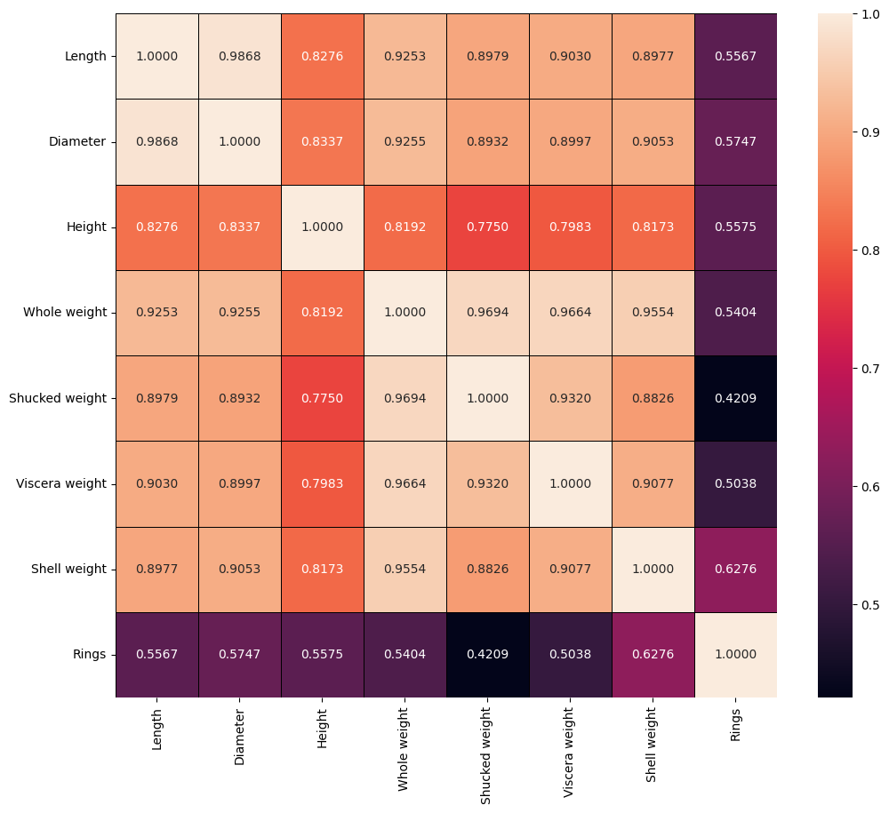
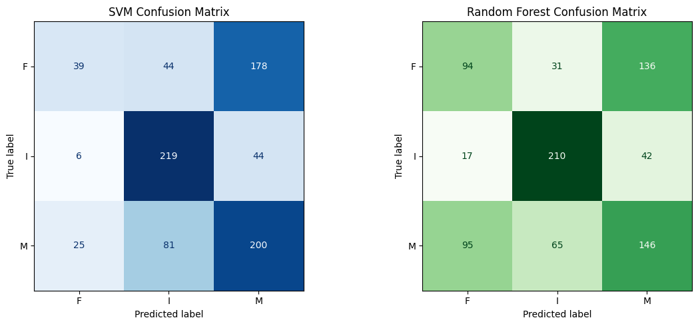
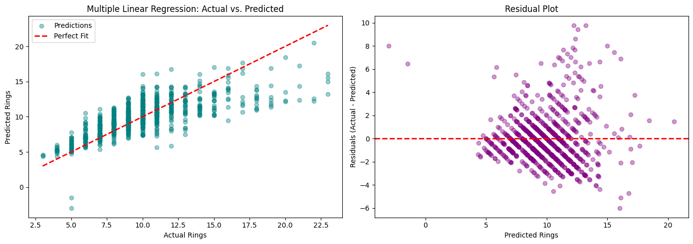
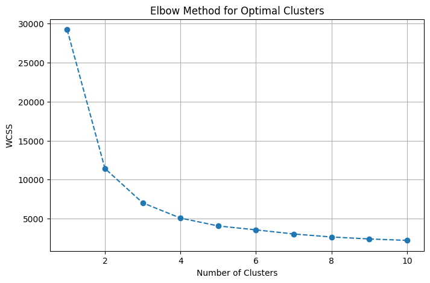
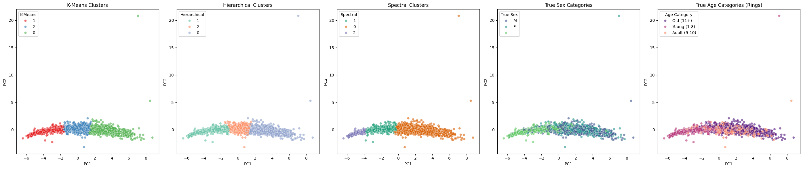

* **Dataset Source:** [UCI Machine Learning Repository - Abalone Data](https://archive.ics.uci.edu/dataset/1/abalone) (Nash et al., 1994; Donor: Sam Waugh, 1995)
* **Tools & Libraries:** Python, Pandas, NumPy, Scikit-Learn, Matplotlib, Seaborn

---

## Repository Structure
```text
├── Abalone_Analysis.ipynb              # Complete Jupyter Notebook with code, visualizations, and discussions
├── Correlation_matrix.png              # Correlation between features and target
├── Confusion_matrix.png                # Classification confusion matrices (SVM vs. Random Forest)
├── 2D_multiple_linear_regression.png   # Regression actual vs. predicted and residual plots
├── Elbow_method_clustering.png         # WCSS Elbow curve for determining optimal k=3
├── Clustering.png                      # 5-panel PCA cluster comparison against true Sex and Age
└── README.md                           # Project summary and findings report
```

---

## Data Exploration & Preprocessing Summary
* **Dataset Integrity:** Contains 4,177 samples with no missing values (`NaN`).
* **Target Conversion:** Per dataset documentation, `Rings + 1.5` yields the approximate age in years.
* **Feature Correlation:** `Shell weight` exhibits the strongest linear correlation with `Rings` (`r = 0.628`), followed by `Diameter` (`r = 0.575`) and `Length` (`r = 0.557`).

---

## Part 1: Classification (Predicting `Sex`: Male, Female, Infant)

### Methodology
* **Train-Test Split:** 80% training (3,341 samples) and 20% testing (836 samples) using stratified sampling (`random_state=42`).
* **Models Evaluated:**
  1. **Support Vector Machine (SVM):** Standardized features paired with an RBF-kernel `SVC`, tuned via `GridSearchCV`.
  2. **Random Forest Classifier:** Ensemble decision tree model trained on standardized physical features.

### Results & Evaluation

| Model | Overall Accuracy | Macro Precision | Macro Recall | Macro F1-Score |
| :--- | :---: | :---: | :---: | :---: |
| **Support Vector Machine (SVM)** | **55.0%** | 0.54 | 0.55 | 0.53 |
| **Random Forest Classifier** | **54.0%** | 0.53 | 0.54 | 0.53 |



### Key Findings
* **High Separability for Infants (`I`):** Both models achieved strong performance on the `Infant` class (`F1-score ~0.71–0.73`), as immature abalones are distinctly smaller and lighter than adults.
* **Adult Class Overlap (`M` vs. `F`):** Adult males and females share nearly identical physical dimension distributions (`F1-score ~0.40–0.46`), creating a natural accuracy ceiling around 54–55% when relying solely on external body measurements.

---

## Part 2: Regression (Predicting Age via `Rings`)

### Methodology
* **Train-Test Split:** 80% training and 20% testing (`random_state=42`).
* **Models Evaluated:**
  1. **Simple Linear Regression:** Uses `Shell weight` alone as the single strongest predictor (highest correlation) of `Rings`.
  2. **Multiple Linear Regression:** Uses all 7 continuous physical measurements plus one-hot encoded `Sex` features (`drop_first=True`).

### Results & Evaluation

| Model | Features Used | Mean Squared Error (MSE) | R² Score |
| :--- | :--- | :---: | :---: |
| **Simple Linear Regression** | `Shell weight` only | 6.4859 | 0.4009 |
| **Multiple Linear Regression** | All physical features + `Sex` | **4.8912** | **0.5482** |



### Key Findings
* **Multivariate Advantage:** Incorporating all physical dimensions and sex reduced **MSE by 24.6%** (from `6.4859` to `4.8912`) and increased explained variance (**R²**) from `40.1%` to `54.8%`.
* **Asymptotic Growth & Heteroscedasticity:** Residual plots reveal a fan-shaped error spread and systematic under-prediction for older abalones (`Rings > 15`). Once an abalone reaches maturity, shell growth slows down significantly while rings continue to accumulate, introducing non-linear variance that linear models cannot fully capture.

---

## Part 3: Unsupervised Clustering

### Methodology
* **Feature Selection:** All target variables (`Sex` and `Rings`) were strictly excluded. Clustering was performed solely on the 7 standardized physical measurements.
* **Optimal Cluster Selection:** The **Elbow Method** (Within-Cluster Sum of Squares) showed a distinct inflection point at **`k = 3`**.
* **Algorithms Compared:** K-Means (`k-means++`), Hierarchical (Agglomerative) Clustering, and Spectral Clustering (`nearest_neighbors` affinity), visualized in 2D via Principal Component Analysis (PCA).
* **Domain Alignment Benchmark:** `Rings` were grouped into three age brackets: `Young (1–8)`, `Adult (9–10)`, and `Old (11+)`.




### Key Findings
* **Shape, Layout, and Boundary Structure:** **K-Means** and **Hierarchical Clustering** produced highly consistent, balanced partitions along the primary size axis (`PC1`), whereas **Spectral Clustering** formed uneven boundary cuts due to the continuous density of physical measurements.
* **Alignment with Sex & Age:** Unsupervised clusters primarily organize abalones by **overall body size and developmental stage** rather than biological sex:
  * The small-size cluster aligns closely with **`Infant (I)`** and **`Young (1–8 rings)`** abalones.
  * Medium and large clusters correspond to **`Adult (9–10)`** and **`Old (11+)`** abalones, where `Male` and `Female` specimens overlap heavily.

---
